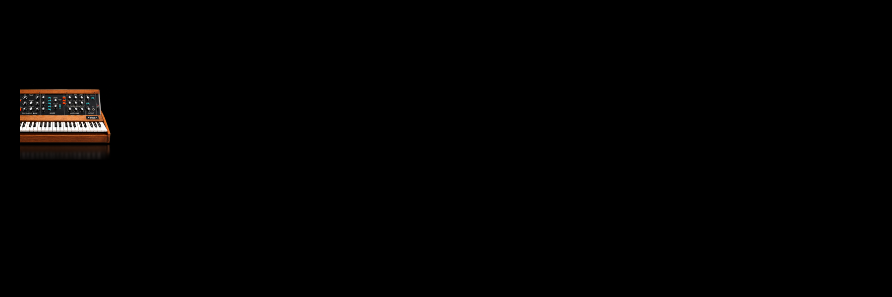
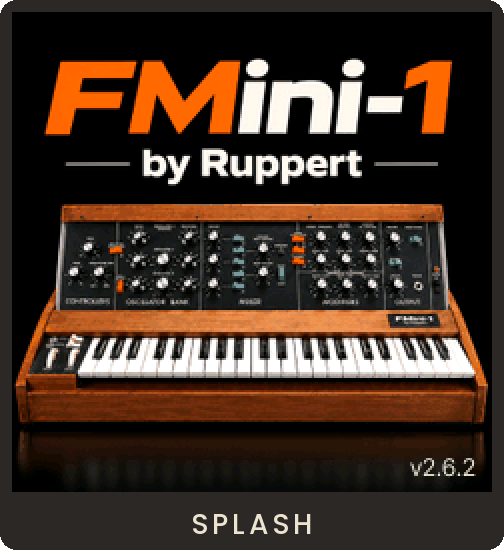
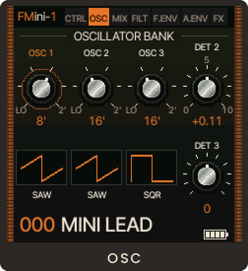
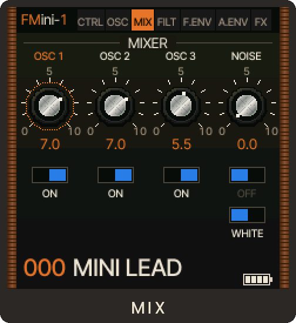
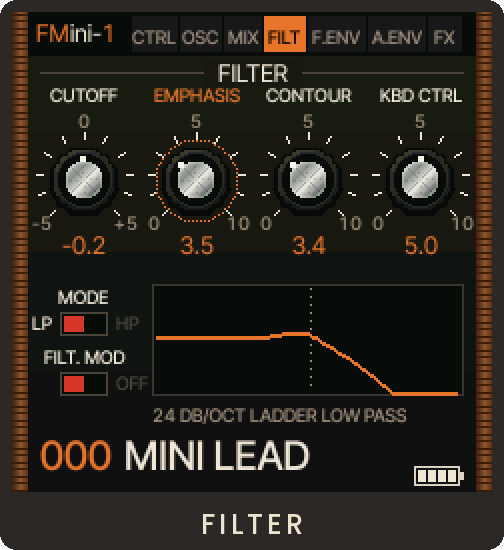
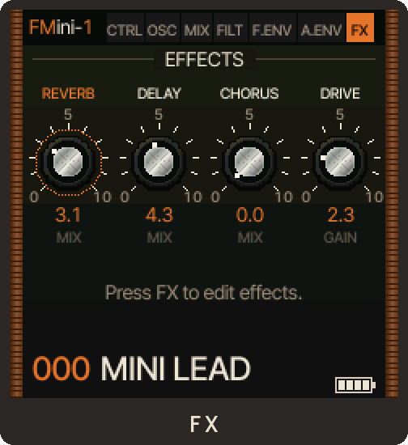
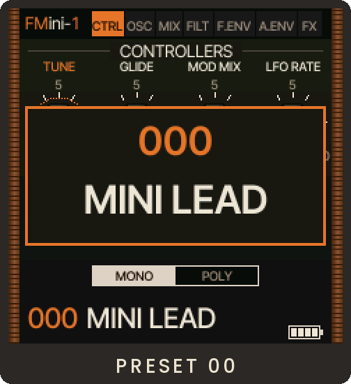
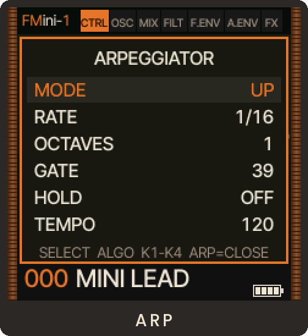
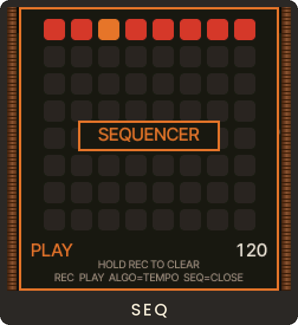

  

  The emulation of the classic Minimoog Model D for the M-Vave FM1 and SMK-37, plus onboard effects, arpeggiator, sequencer and more.

  <video src="docs/fmini-ad.mp4" poster="docs/fmini-ad-poster.jpg" controls width="100%"></video>

  <a href="docs/fmini-ad.mp4">▶ Watch the video (30 s)</a> · <a href="https://ruppert.github.io/fmini-1/emu/">🎹 Try FMini-1 in your browser</a> · <a href="https://ruppert.github.io/fmini-1/editor/">🎛 Patch editor</a>

## 1. Screenshots

  
  
  
  

  
  
  
  

## 2. Installation

Official site: <https://ruppert.github.io/fmini-1/> (with Web Installer)

Supports the new FM-1 versions (with the UC25HQ80 flash chip).

### Verified firmware packages (v2.6.8)

| Model | Package |
|---|---|
| FM-1 | [fmini-1-fm1-2.6.8.fwsc](https://github.com/loudmantrade/fmini-1/releases/download/v2.6.8/fmini-1-fm1-2.6.8.fwsc) |
| SMK-37 Pro | [fmini-1-smk37-2.6.8.fwsc](https://github.com/loudmantrade/fmini-1/releases/download/v2.6.8/fmini-1-smk37-2.6.8.fwsc) |
| SMK-37 Elite | [fmini-1-smk37-elite-2.6.8.fwsc](https://github.com/loudmantrade/fmini-1/releases/download/v2.6.8/fmini-1-smk37-elite-2.6.8.fwsc) |
| MKE-P37 | [fmini-1-smk37-mke-2.6.8.fwsc](https://github.com/loudmantrade/fmini-1/releases/download/v2.6.8/fmini-1-smk37-mke-2.6.8.fwsc) |

All four packages were target-built. The FM-1 package was installed and its firmware version confirmed; physical dotted ARP/A-SYNC timing was not tested. The SMK-37 packages have not been tested on hardware.

## 3. Credits

FMini-1 was made by Guilherme Ruppert. It is inspired and partially based on the [Felucca](https://github.com/hugelton/Felucca) project by Leo Kuroshita (Hügelton Instruments).

This fork is supported by [Alex Loudman](https://github.com/loudmantrade).

**AI disclaimer:** this project was developed with the assistance of [Claude](https://claude.ai), an AI model by Anthropic.

Based on <a href="https://github.com/hugelton/Felucca">Felucca</a> by Leo Kuroshita · <a href="LICENSE">GPL-3.0-only</a>

